<p align="center">
  
</p>

# Revedroid

[](https://github.com/Lilithbtw/Revedroid/actions/workflows/ci.yml)
[](https://github.com/Lilithbtw/Revedroid/releases/latest)
[](LICENSE)


Revedroid is an Android client for [Cloudreve](https://cloudreve.org) v4, built with Kotlin, Jetpack Compose and Material 3. It lets you sign in to your Cloudreve server from your phone and manage your files: browse folders, upload and download, share links, and empty the trash.

## Screenshots

| Files | Photos | Selecting | Moving |
|---|---|---|---|
| 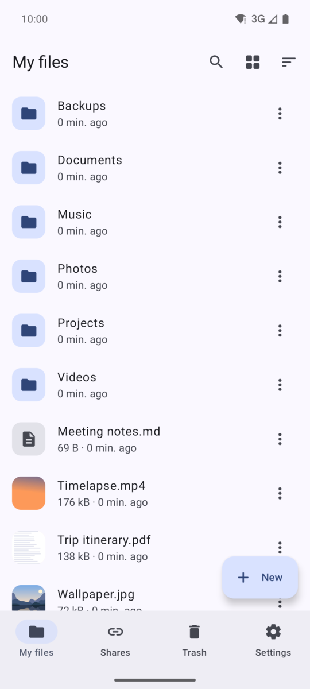 | 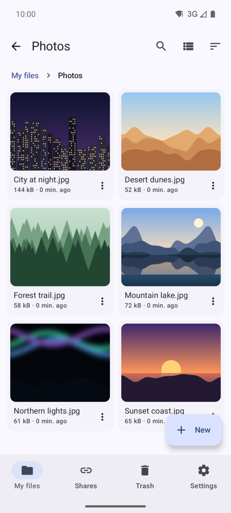 | 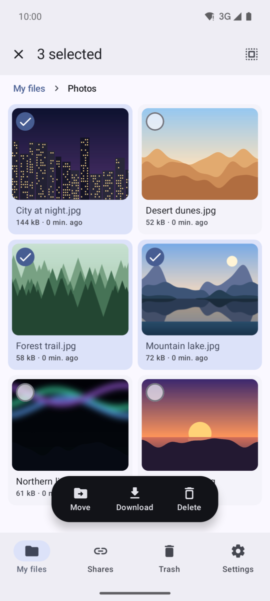 | 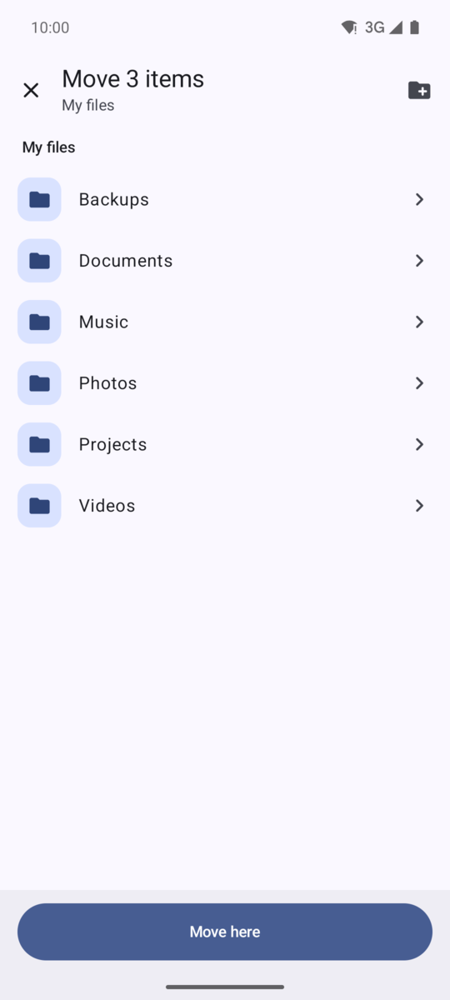 |

| Share from any app | Choose a folder | Upload progress | Share links |
|---|---|---|---|
| 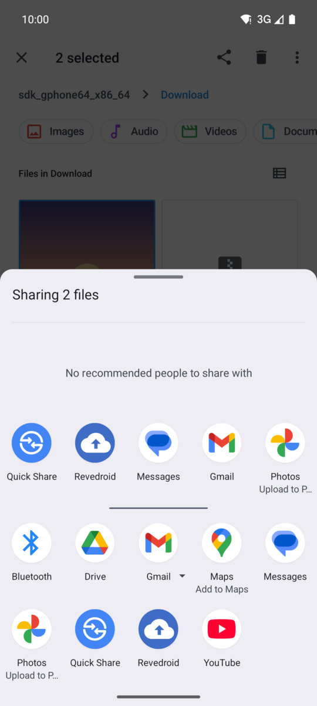 | 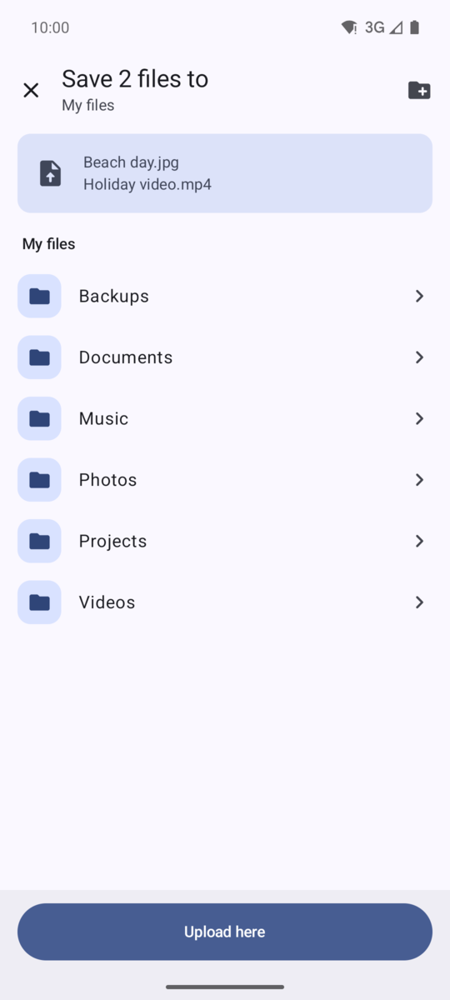 | 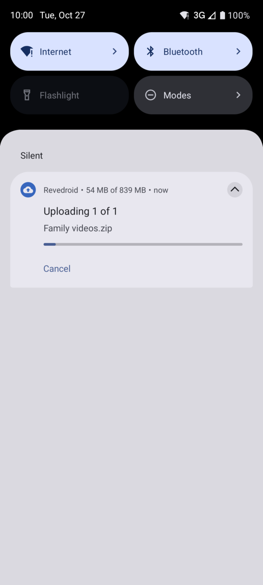 | 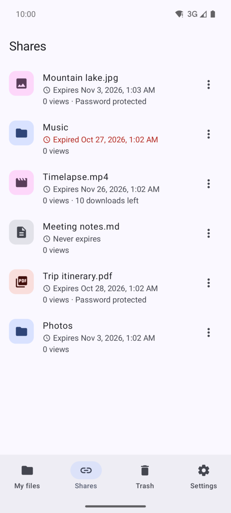 |

| New share link | Settings | App lock | Dark theme |
|---|---|---|---|
| 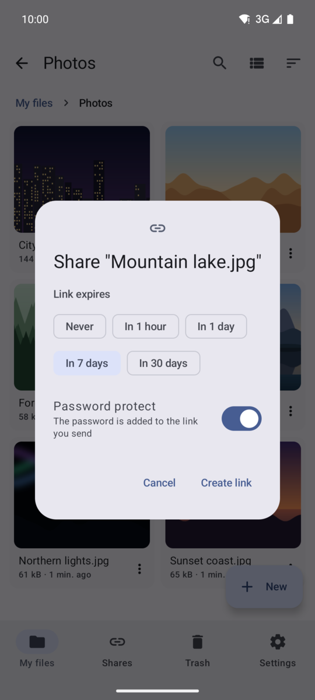 | 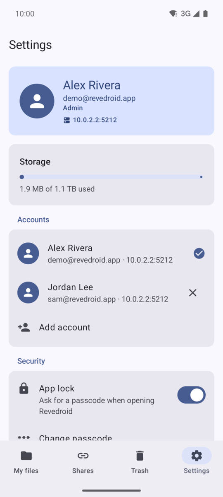 | 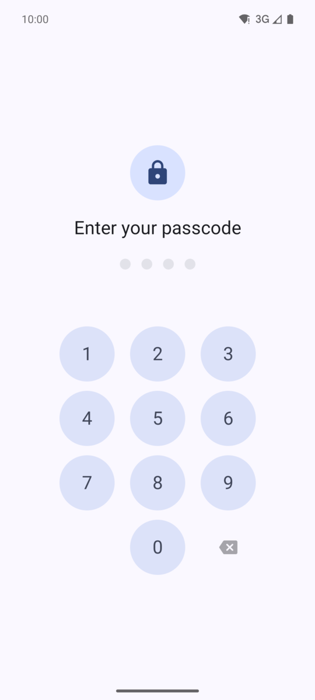 | 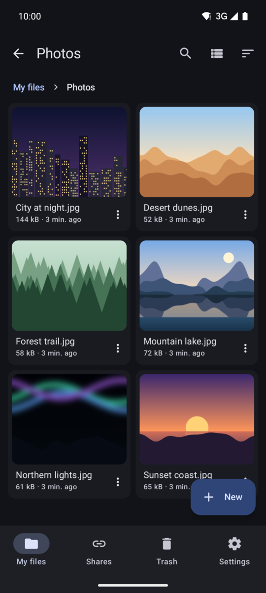 |

The screenshots come from Android 16 in the emulator, against a local Cloudreve 4.19 server with generated sample files.

## Why it exists

Many Cloudreve servers sit behind Cloudflare, and Cloudflare often blocks apps that don't behave like a browser. Revedroid handles that case. When Cloudflare asks for a check, the app shows it in a WebView, then keeps the resulting session, so you don't repeat the check every time.

## Download

Download the latest APK from the [releases tab](https://github.com/Lilithbtw/Revedroid/releases), then install it on your Android device. You may need to allow installs from your browser or file manager first.

Each version is published as two releases. The `vX.Y.Z` release has `revedroid-vX.Y.Z.apk`, which updates itself from GitHub. The `vX.Y.Z-fdroid` release has `revedroid-vX.Y.Z-fdroid.apk`, the F-Droid build: it leaves out the updater and the permission to install apps, so you update it through F-Droid or by hand. Both are signed with the same key and use the same package name, so you can switch between them without losing your data.

Release APKs are signed with the project's release key, so each release installs over the one before and keeps your sign-in and settings. You don't need to uninstall first.

## Updating

When you open Revedroid, it checks GitHub for a new release (at most twice a day) and offers to install it. You can also check yourself under Settings, then Updates and about. The update downloads inside the app and Android installs it over the current version, so you stay signed in. The first time, Android asks you to let Revedroid install apps; allow it once and later updates only need a tap on "Update".

Each release gets its version from its tag: `v0.1.3` becomes version 0.1.3 with version code 1003. Releases up to v0.1.2 all reported version 0.1.0 (code 1), so neither Android nor update tools could tell them apart. From v0.1.3 on, every release has a higher version code than the last, and v0.1.3 installs over any earlier release.

Debug builds use the package name `app.revedroid.debug` and show up as "Revedroid Debug", so they install next to the release app instead of clashing with it. They don't update themselves, and neither does the F-Droid build.

## Features

- Sign in with your password, including Cloudreve's login captchas (image, reCAPTCHA, Turnstile, and Cap) and two-factor codes.
- Tokens are stored encrypted with an Android Keystore AES-GCM key and refreshed before they expire.
- Browse files as a list or a grid, with thumbnails, breadcrumbs, sorting, search, pull-to-refresh, and pagination.
- Create folders, rename items, move them to the trash, and download files through the system DownloadManager.
- Long-press to select several items. A bar at the bottom moves, downloads or deletes them all at once, or restores and deletes them in the trash.
- Move files and folders to another folder with a folder picker.
- Uploads run in the background with a progress notification and a Cancel button, so you can leave the app while they finish.
- Share files from any app to Revedroid. It asks which folder to upload them to, remembers the last folder you used, and uploads in the background. Shared text becomes a `.txt` file.
- Create share links that expire after an hour, a day, a week or a month, optionally with a password. To share several items with one link, select them and tap Share. Cloudreve links only a single file or folder, so Revedroid copies the items (or, if you choose, moves them) into a new folder and links that folder. The Shares tab lists your links with their expiry dates, view counts and remaining downloads, and lets you copy, send, open or delete each one.
- Tap a photo, video, song, or PDF to open it in the app, with pinch-to-zoom for photos and PDFs. Other files open in another app, and every file's menu has an "Open with" entry for choosing the app yourself.
- Restore items from the trash, delete them permanently, or empty the trash.
- Upload in chunks to `local` and `remote` (slave node) storage policies, and to any policy running in relay mode.
- Sign in to several accounts, on the same server or on different ones, and switch between them from Settings or the connect screen.
- Lock the app with a 4 to 8 digit passcode, optionally unlocked with your fingerprint or face, and choose how long the app can stay in the background before it locks again.
- Hide the app's content from screenshots and the recent apps screen.
- See your storage usage, choose a theme, use Material You dynamic color, set the default expiry for new links, clear cached files, sign out, or switch servers from Settings.

## How connecting works

Enter your server address. If you leave out the scheme, Revedroid assumes HTTPS. If you paste a full `/api/v4` URL, the suffix is removed for you, and installs that live under a sub-path keep their path.

The app then checks that the server is reachable:

- If there is no Cloudflare challenge, the app connects right away.
- If Cloudflare shows a challenge, the app opens it in a WebView so you can pass the check. It then tries again, with backoff, until the server responds.
- If Cloudflare blocks the request outright (error 1020, for example), the app tells you so. Retrying won't help in that case.

Once the server is reachable, the app signs you in, or takes you straight to your files if it already has a valid session for that server.

The Cloudflare clearance cookie is stored in the WebView's cookie manager and shared with the app's HTTP client, so it survives restarts. Requests also use the WebView's User-Agent, because Cloudflare ties clearance to it. If the clearance expires during use, Revedroid shows the verification screen again and refreshes the current view afterwards.

## Not supported yet

- Direct uploads to third-party object storage (S3, OSS, COS, OneDrive, and similar) when relay mode is off.
- Passkey, SSO, and OAuth sign-in, registration, and password reset.
- Copying files, previews for text and office documents, editing existing share links, WebDAV, and offline downloads.
- Uploads keep going in the background, but they don't resume if Android stops the app or the phone restarts.
- Uploading a file to a folder that already has a file with that name fails; the app doesn't rename or replace it.

## Compile from source

Requirements: JDK 17 and the Android SDK with compileSdk 37.2. The minimum supported Android version is 29 (Android 10).

```sh
git clone git@github.com:Lilithbtw/Revedroid.git
cd Revedroid
./gradlew :app:assembleGithubDebug
```

The APK is written to `app/build/outputs/apk/github/debug/app-github-debug.apk`. You can also open the project in Android Studio.

The version name comes from the newest `v*` tag in your checkout. Pass `-PrevedroidVersion=1.2.3` to set it yourself.

To run the unit tests (URL handling, ping, Cloudflare detection, version comparison, passcode hashing, request building, and parsing of share and trash listings):

```sh
./gradlew :app:testGithubDebugUnitTest
```

### Release builds

`./gradlew :app:assembleRelease` builds and signs both flavors, at `app/build/outputs/apk/github/release/app-github-release.apk` and `app/build/outputs/apk/fdroid/release/app-fdroid-release.apk`. Signing values come from a local `keystore.properties` file, which looks like this:

```properties
storeFile=revedroid-release.jks
storePassword=…
keyAlias=revedroid
keyPassword=…
```

Neither the keystore nor this file is committed, and `.gitignore` excludes both. You can also set `REVEDROID_KEYSTORE_PATH`, `REVEDROID_KEYSTORE_PASSWORD`, `REVEDROID_KEY_ALIAS`, and `REVEDROID_KEY_PASSWORD` as environment variables. If neither source is set, the release APK is built unsigned.

Back up the keystore. Android only installs updates signed with the same key, so losing it means existing users have to uninstall the app before they can upgrade.

### F-Droid build

The app has two product flavors. `github` is the default and includes the in-app updater. `fdroid` leaves it out: it doesn't request `REQUEST_INSTALL_PACKAGES`, doesn't register the install receiver, and never checks GitHub for releases. Neither flavor uses Google Play services or Firebase, and neither APK includes the dependency metadata block that Google Play encrypts and F-Droid rejects.

F-Droid builds the `fdroid` flavor from a release tag:

```sh
./gradlew :app:assembleFdroidRelease -PrevedroidVersion=1.2.3
```

In F-Droid metadata, that's `gradle: [fdroid]` on each build entry. Without a keystore, the APK is written unsigned to `app/build/outputs/apk/fdroid/release/app-fdroid-release-unsigned.apk`.

## Code style

Kotlin is checked with [ktlint](https://github.com/pinterest/ktlint), using the `ktlint_official` style defined in `.editorconfig`:

```sh
./gradlew ktlintCheck     # report problems
./gradlew ktlintFormat    # fix what can be fixed automatically
```

## Continuous integration

| Workflow | Runs on | Purpose |
|---|---|---|
| `ci.yml` | pushes to `main`, pull requests | ktlint, Android lint (results go to code scanning), unit tests, and a debug APK artifact. A separate job builds the unsigned F-Droid release APK, and fails if it depends on Google Play services or Firebase or can install apps |
| `codeql.yml` | pushes to `main`, pull requests, weekly | CodeQL `security-extended` analysis of the Kotlin code |
| `release.yml` | CI passing on a push to `main` that changes more than Markdown, tags matching `v*` | Creates the next patch tag, builds the signed GitHub and F-Droid APKs with that version, checks the F-Droid APK again, and publishes them as two GitHub releases, `vX.Y.Z` and `vX.Y.Z-fdroid` |
| `dependabot-auto-merge.yml` | Dependabot pull requests | Enables auto-merge for patch and minor updates |

Dependabot checks Gradle dependencies, including `gradle/libs.versions.toml`, and GitHub Actions each week. Related libraries are grouped, so Kotlin and its compiler plugins update together.

To set up a fork or a new repository:

1. Add the secrets `REVEDROID_KEYSTORE_BASE64` (the output of `base64 -w0 revedroid-release.jks`), `REVEDROID_KEYSTORE_PASSWORD`, `REVEDROID_KEY_ALIAS`, and `REVEDROID_KEY_PASSWORD` under Settings, then Secrets and variables, then Actions.
2. Turn on "Allow auto-merge" under Settings, then General. Add a branch ruleset on `main` that requires the `ktlint`, `Android lint, tests & build`, `F-Droid build`, and `Security analysis (Kotlin)` checks. Dependabot pull requests then merge only after those pass. Major version bumps are never merged automatically.
3. Code scanning results appear under Security, then Code scanning. On private repositories, this needs GitHub Advanced Security.

The ktlint engine version (`ktlintEngine` in the version catalog) is not a normal dependency, so Dependabot doesn't update it. Update it by hand when the Gradle plugin changes.

## Project layout

```
data/api     Retrofit interface and models for /api/v4 (envelope: code, data, msg)
data/net     Cookie jar shared with the WebView, Cloudflare detection, auth and token refresh
data/repo    Ping, auth, files, share links, downloads
data/store   DataStore settings, the encrypted accounts, passcode and app lock
data/upload  Upload queue and the foreground service with its notification
data/update  Release check and in-app install
ui/connect   Server entry, saved accounts, and the ping and challenge state machine
ui/challenge Cloudflare WebView
ui/login     Sign-in, two-factor, and captcha widgets
ui/files     File browser, selection bar, folder picker, sheets, and dialogs
ui/shares    Share link list
ui/share     "Save to" screen for files shared from other apps
ui/lock      Passcode screen and biometrics
ui/viewer    In-app viewer for photos, videos, audio, and PDFs
ui/account   Settings: profile, storage, accounts, security, appearance, updates
ui/update    Update prompt and download progress
ui/navigation  Navigation graph
ui/components  Shared error and permission helpers
ui/theme     Material 3 theme and dynamic color
```

The launcher icon's editable SVG sources and a 512 px PNG for app stores are in `docs/icon`.

## Contributing

Bug reports and pull requests are welcome on [GitHub](https://github.com/Lilithbtw/Revedroid/issues). Before opening a pull request, run `./gradlew ktlintCheck :app:testGithubDebugUnitTest`; CI runs the same checks, plus Android lint and the F-Droid build. If you report a connection problem, say which Cloudreve version you run and whether the server is behind Cloudflare.

## License

Revedroid is free software, licensed under the [GNU Affero General Public License v3.0](LICENSE) or, at your option, any later version. It comes with no warranty. See [LICENSE](LICENSE) for the full terms.
